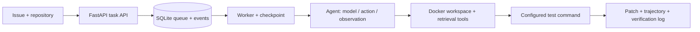

# CS427-agent

Personal project for CS427, Fall 2025, by [xiaofei9289](https://github.com/xiaofei9289).

This repository extends [mini-swe-agent](https://github.com/SWE-agent/mini-swe-agent) with tool calling and memory, and keeps the midterm and final course deliverables. Copyright for the upstream code remains with the original authors. See `LICENSE.md`.

## Contents

- `src/minisweagent/`: the agent, environments, models, and the course extensions for tools and memory
- Tools: `read_file`, `write_file`, `refined_read_file`, `read_many_files`, `search_file_content`, `replace`, `find_definition`, `todo`
- Memory: `HistoryManager` keeps the task and complete recent action/observation turns, and summarizes omitted execution evidence; `memory_search` returns full matching messages or opens one by index; `SessionMemory` and `TrajectoryReplayer` store and replay runs
- Retrieval: environment-side Python AST indexing with BM25/symbol search (`code_search`, `repo_map`); `find_definition` uses the same index for exact symbol lookup
- Service: persistent FastAPI task queue, per-task Git workspaces, cancellation/resume, checkpoints, budget finalization, event traces, independent tests and candidate patches saved before verification
- Evaluation: frozen task/config/source manifests, per-run integrity audits and matched baseline/retrieval and [budget finalization comparisons](experiments/budget_20261017)
- `deliverables_midterm/`, `deliverables_final/`: SWE-bench run results and reports
- `tests/`: tests for tools, memory, and the run flow

## Installation

Python 3.10 or newer is required.

```bash
git clone https://github.com/xiaofei9289/2025Fall_CS427_agent.git
cd 2025Fall_CS427_agent
pip install -e .
```

Development dependencies:

```bash
pip install -e ".[dev]"
```

If the virtualenv was created by `uv venv` without `--seed`, it has no pip; run
`python -m ensurepip --upgrade` first, or use
`uv pip install -e ".[dev]" --python .venv/bin/python`.

For the HTTP service, install `pip install -e '.[service,dev]'`. Run all tests and Docker builds on the desktop Linux/WSL environment; see [deployment guide](deployment/README.md). The local Mac is used for editing only.

The reproducible V2 baseline, including exact acceptance commands and the
public-main/interface inventory, is in [docs/v2_baseline.md](docs/v2_baseline.md).

## Architecture and evidence



The historical course runs resolved 19/50 and 25/50 selected tasks. They are not a controlled ablation: budgets/configurations differ (the final run mixed 50/100/250 step limits, and none of them enabled memory). See [run audits](experiments/baseline_audit) for evidence boundaries; the audited final run has 50 trajectories and no integrity issues. A new [five-task controlled pilot](experiments/pilot_20261017) was graded on the desktop: baseline 3/5 and retrieval 4/5, with no integrity issues. Those retrieval trajectories never called the new search tools. A later [gated rerun](experiments/gate-20261017) required a search call first: baseline resolved 4/5, and retrieval resolved 3/5 with one empty submission. That is still one run of five tasks.

The service reports success only when a nonempty patch passes its configured test command. That is separate from the official SWE-bench outcome. This remains a trusted single-operator prototype; it does not yet demonstrate public multi-tenant operation or production traffic.

## Run

```bash
mini
```

With the visual interface:

```bash
mini -v
```

From Python:

```python
from minisweagent.agents.default import DefaultAgent
from minisweagent.environments.local import LocalEnvironment
from minisweagent.models.litellm_model import LitellmModel

agent = DefaultAgent(
    LitellmModel(model_name="..."),
    LocalEnvironment(),
)
agent.run("Write a sudoku game")
```

## Tests

```bash
pytest -q            # offline regression suite; slow tests are deselected by default
pytest -q -m slow    # Docker/Singularity, terminal, and Hugging Face network tests
python scripts/verify_v2_baseline.py  # import, tools, config, and offline tests
```

Run the scoped checks on the desktop using the [deployment guide](deployment/README.md). Latest V2 local validation: 567 passed, 19 skipped, 50 slow tests deselected; Ruff and the HTTP/Docker demo with finalization events and API restart passed previously. See [validation records](desktop_validation/README.md). Some upstream tests require external model services or Docker and are not part of the offline regression suite.

## Documentation

- Tool extension: `cs427_tools_extension.md`
- Memory extension: `cs427_memory.md`
- V2 reproducible baseline: [docs/v2_baseline.md](docs/v2_baseline.md)
- Delivery and interview notes: [project delivery](docs/project_delivery.md)
- Controlled experiment plan: [experiments/PLAN.md](experiments/PLAN.md)
- Clean A/B/C memory experiment: [design](experiments/memory_abc_20261019/DESIGN.md) and [runbook](experiments/memory_abc_20261019/README.md)
- Upstream docs: <https://mini-swe-agent.com/latest/>

## Acknowledgments

This project is based on [mini-swe-agent](https://github.com/SWE-agent/mini-swe-agent) and [SWE-agent](https://github.com/SWE-agent/SWE-agent) from the Princeton and Stanford teams. If you find this work helpful, please cite the [SWE-agent paper](https://arxiv.org/abs/2405.15793).
