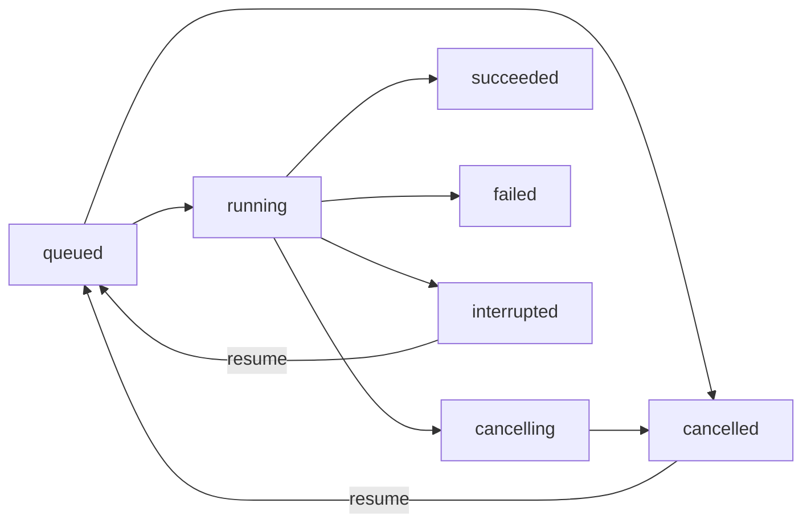

# 台式机运行与演示

按项目约定，所有后续测试、SWE-bench 验收和镜像构建在台式机执行。本地 Mac 仅编辑代码，不缓存 Docker 镜像。服务和集成测试需要 Linux，可使用台式机的 WSL 或 Docker Desktop Linux 容器；原生 Windows 不支持当前 worker 使用的 POSIX 进程组及文件锁。

## Mac → 台式机同步（推荐流程）

Mac 负责修改和提交，台式机只运行测试。同步脚本把**已提交**的代码、测试、部署和实验配置
打包到 `D:\cs427-workspace`，替换代码目录并校验与 `run_manifest.json` 相同的 source 指纹。

```bash
# Mac：工作区必须干净（只允许未跟踪的 uv.lock）
python deployment/sync_desktop.py --target D:/cs427-workspace

# 台式机：在同步目标中测试
ssh desktop-pc "cd D:/cs427-workspace; python deployment/desktop_run.py checks"
ssh desktop-pc "cd D:/cs427-workspace; python deployment/desktop_run.py slow-checks"
```

- 同步会替换 `src/`、`tests/`、`deployment/`、`SWE-bench/`、`docs/`，保留 `experiments/`
  下的运行结果和 `desktop_validation/`；实验配置和 runner 会覆盖更新。目标目录有实验在
  运行时先停止，避免中断正在使用的 `src/`。
- `D:\cs427-upgrade-20261017` 保留为历史实验副本，不要覆盖；新测试统一在
  `D:\cs427-workspace`。
- 脚本拒绝脏工作区；先提交再同步。`uv.lock` 允许保持未跟踪，但会打进压缩包并参与指纹。
- 同步结束会打印 `source.sha256`；台式机返回的结果必须与 Mac 一致，否则脚本失败。
- 可选参数：`--host`（默认 `desktop-pc`）、`--target`、`--remote-tar`。

## 安装与测试

Windows 台式机可通过 `deployment/desktop_run.py` 使用 Docker Linux 引擎完成同一组检查。该脚本拒绝在 Mac 执行，并使用独立的匿名 Docker 配置解决 SSH 会话无法读取 Windows 凭据库的问题，不修改用户已有登录配置。

```powershell
python deployment/desktop_run.py build
python deployment/desktop_run.py checks
python deployment/desktop_run.py slow-checks
python deployment/desktop_run.py demo
python deployment/desktop_run.py grading
```

`checks` 是不含 slow 的快速回归；完整验证还需运行 `slow-checks`。后者覆盖
`tests/run/test_swebench.py` 中 9 项 Docker 运行流程测试，需要公开 dummy 数据集和测试镜像
可下载（或已缓存），使用固定轨迹和模拟模型，不产生模型 API 费用。两组日志分别保存为
`desktop_validation/pytest.log` 和 `desktop_validation/pytest_slow.log`。

Docker Hub 连通性受限时，可用 `python deployment/desktop_run.py build --official-mirror` 从 [Docker 官方 ECR Public 分发](https://www.docker.com/blog/news-from-aws-reinvent-docker-official-images-on-amazon-ecr-public/)取得 Python 与 Docker CLI 基础镜像。SWE-bench 的任务镜像仍来自其官方 Docker Hub 命名空间，因此正式评分仍需要 Docker Hub 连通。

`desktop_validation` 保存各阶段的退出码、耗时和日志；`demo` 使用明确标记的 deterministic 模型验证真实 HTTP → Docker 工作副本 → pytest → 补丁产物流转，不作为模型性能证据。它会在完成后移除自己启动的 API 容器，并保留专用数据卷和结果文件。下面的直接运行方式适用于台式机上的 Linux / WSL。

首次构建后，如果只修改 Python 源码、没有改变依赖，可用 `python deployment/desktop_run.py refresh` 更新服务镜像，复用已安装的依赖，然后重跑 checks / demo。依赖或基础镜像变更仍用 build。

```bash
python3.11 -m venv .venv
.venv/bin/python -m pip install -e '.[service,dev]'
.venv/bin/python -m pytest tests/service tests/tools tests/memory tests/run/test_audit.py tests/run/test_experiment.py tests/run/test_compare.py tests/run/test_localization_eval.py tests/run/test_swebench.py -k 'not slow' -q
.venv/bin/ruff check src/minisweagent/service src/minisweagent/run/service.py src/minisweagent/run/extra/compare.py tests/service tests/run/test_compare.py
```

## 运行 HTTP 服务

先在台式机构建执行环境。该基础镜像包含 Python、git、pytest；具体项目的依赖应由运营者在派生镜像里预装，任务容器默认没有网络。

```bash
docker build -f deployment/Dockerfile.sandbox -t miniswe-sandbox:local .
export MSWEA_SERVICE_DATA_DIR="$HOME/cs427-agent-tasks"
export MSWEA_SERVICE_REPO_ROOT="$HOME/agent-input-repos"
mkdir -p "$MSWEA_SERVICE_DATA_DIR" "$MSWEA_SERVICE_REPO_ROOT"
# 在台式机环境配置 DEEPSEEK_API_KEY；不要写入仓库或请求体。
.venv/bin/python -m minisweagent.run.service
```

打开 `http://127.0.0.1:8000/docs` 查看接口。GitHub HTTPS 地址和 `repo_root` 下的本地 Git 仓库均可提交：

```bash
curl -sS http://127.0.0.1:8000/tasks -H 'Content-Type: application/json' \
  -d '{"repo":"https://github.com/your-org/your-repo","issue":"Describe the bug and expected behavior","variant":"retrieval"}'
curl -sS http://127.0.0.1:8000/tasks/TASK_ID
curl -sS 'http://127.0.0.1:8000/tasks/TASK_ID/events?after=0'
curl -sS -X POST http://127.0.0.1:8000/tasks/TASK_ID/cancel
curl -sS -X POST http://127.0.0.1:8000/tasks/TASK_ID/resume
curl -sS http://127.0.0.1:8000/tasks/TASK_ID/artifacts/patch.diff
```

任务会调用配置的模型并发送所提交的 Issue、仓库片段和工具输出；每任务默认停止阈值为 50 次调用、1 美元、300 秒。费用在响应后累计，因此阈值可能多出一次调用；时间在模型调用前检查，不是硬实时保证。服务端配置决定模型、镜像、测试命令，客户端只能选择 baseline / retrieval。

## 状态与恢复



SQLite 保存队列、状态和可分页事件。每任务有独立 Git 克隆、worker 进程、日志、checkpoint 和产物。checkpoint 保留完整对话及累计调用数、成本；恢复不会重置这些预算，运行时间按每次恢复重新计时。进程中断时，正在执行的动作可能已部分生效；恢复会让模型先检查工作副本，不自动重放该动作。服务重启后，运行中的任务标记为 interrupted，排队任务继续调度。

服务默认在剩余 5 次调用、45 秒或 0.10 美元时进入收尾阶段，提示停止扩散搜索、完成修改与提交；总预算保持不变。`stage` 可查看 `finalizing`、`exporting`、`verifying`；候选补丁在独立验收前就会原子保存，验收超时仍可下载。结果中的 `submission_kind` 区分主动提交与退出后恢复，`verification_status` 标明验收是否通过；checkpoint 记录收尾阶段，恢复后不重复插入提示。配置与边界见 [预算收尾说明](../docs/budget_finalization.md)。

`succeeded` 只表示存在非空补丁且服务端配置的测试命令返回 0，不能等同于 SWE-bench 官方通过。验收失败也保留候选补丁。模型输出和工具结果可从 trajectory 下载；events 记录调用成本、token usage、动作耗时与验收结果。模型 API 异常与运行错误也会保留在事件和 worker.log。

服务使用一个 API 进程，`--workers N` 只增加任务 worker 数；同一个数据目录不能开多个 API 进程。默认仅监听 loopback；可用 `MSWEA_SERVICE_TOKEN` 设置 Bearer token。这是可信单用户的开发服务，尚未实现租户隔离、OAuth、分布式队列或公网运维。Docker socket 只交给服务端，任务容器只挂载自己的工作副本，不转发 API key。

## Compose

```bash
docker compose -f deployment/compose.yaml --profile build build
docker compose -f deployment/compose.yaml up -d api
```

`MSWEA_SERVICE_REPO_ROOT` 为台式机上的仓库父目录，挂入容器的 `/repos`。任务数据写入 `cs427-agent-data` 命名卷；worker 从 Docker 查询该卷在 daemon 内的实际路径，只把当前任务的 workspace 挂进执行容器。这也支持 Windows Docker Desktop，不依赖服务容器与 Windows 宿主具有相同的路径。API key、service token 只经运行环境传入。停止服务用 `docker compose -f deployment/compose.yaml down`，不要加 `-v` 删除数据卷。

## 五题官方验收

既有两组预测已经生成，验收无需再次调用模型。台式机需要安装仓库内 `SWE-bench` 评测器的依赖（`.venv/bin/python -m pip install -e ./SWE-bench`），然后运行：

```bash
.venv/bin/python experiments/pilot_20261017/evaluate.py
.venv/bin/python -m minisweagent.run.extra.compare \
  experiments/pilot_20261017/baseline experiments/pilot_20261017/retrieval \
  experiments/pilot_20261017
```

`evaluate.py` 拒绝在 macOS 运行，只下载这 5 题的公开 x86_64 测试镜像，逐组调用官方 harness。每组的参数、grading_summary 和逐题日志独立保留。本地失败尝试存入 `local_evaluation_attempt`，不作为正式结果。样本量为 5、每组一次，最终结果用于验证流程和发现问题，不能据此宣称总体效果提升。

新增预算收尾对照的原始结果与统一换行修正后的评分见 [实验报告](../experiments/budget_20261017/README.md)。其 `run.py grading` 保留原始评分错误，`run.py normalized-grading` 仅在副本上补齐缺失的末尾 LF 并验收，不调用模型。新导出器已保留 diff 的尾部结构，回归直接验证导出字节可应用。
